# Components of the backend

Level 3 of the [C4 model](README.md): the services inside the Co-Review backend (`extensions/review/src/node`). Each one handles one concern; the [architecture page](../architecture.md) describes each in prose. To keep the diagram readable it leaves out `SyntaxServiceImpl` (Tree-sitter symbols and token anchors, a second JSON-RPC service the window calls), `OverviewPages` (rewrites a review's overview page whenever the store changes), and the smaller helpers: agent setup commands, window bookkeeping, agent presence, the debug log.

```mermaid
C4Component
  title Component diagram for the Co-Review backend

  Container(frontend, "Review workbench", "Theia frontend", "The window")
  ContainerDb(store, "Review home", "JSON files under ~/.co-review", "Reviews, snapshots, map, pages")
  Container(cli, "co-review command", "Node.js CLI", "stdio to HTTP bridge for agents")
  Container(phone, "Phone view", "HTML and JavaScript", "The reviewer's phone")

  Container_Boundary(backend, "Co-Review backend") {
    Component(reviewService, "ReviewServiceImpl", "Theia JSON-RPC service", "One per window: every review operation the window needs")
    Component(reviewStore, "ReviewStore", "Serialized writer", "Persists reviews, broadcasts every change")
    Component(mcp, "CoReviewerMcp", "MCP server, Streamable HTTP", "The /mcp endpoint: open_review, add_findings, await_reviewer, reply, repo_map, repo_facts, ask_reviewer")
    Component(mobile, "MobileReview", "HTTP handler", "The /m/ page and its REST API, over the review store")
    Component(acp, "AcpAgentService", "ACP client", "Launches an agent, one session per thread, streams its answer")
    Component(anchors, "AnchorTracker", "diff-match-patch, CodeMirror", "Follows a comment's code across edits; reads snapshots from the store")
    Component(bundle, "BundleService", "File reader", "Review directories: document, patches, PR.md, findings, review.json")
    Component(repoIndex, "RepoIndex", "Tree-sitter outline, Graphify", "Repository map, coverage, repository overview")
    Component(decisions, "HumanDecisions", "Pending promises", "ACP permissions and ask_reviewer, answered from the thread")
    Component(githubReviews, "GitHubReviews", "gh api", "Posts a pull request review to GitHub")
    Component(codeFolders, "CodeFolders", "git worktree", "The code a change review opens on; created by ReviewServiceImpl and CoReviewerMcp")
    Component(repoFacts, "RepoFacts", "Import graph, git log", "Entry points, folder roles, naming, history")
  }

  Rel(frontend, reviewService, "Calls", "JSON-RPC")
  Rel(reviewStore, store, "Writes, reads snapshots", "file system")
  Rel(cli, mcp, "Tool calls", "Streamable HTTP")
  Rel(phone, mobile, "Reads, answers", "REST")

  Rel(reviewService, reviewStore, "Reads, changes")
  Rel(reviewService, acp, "Connects, asks")
  Rel(acp, reviewStore, "Streams answers")
  Rel(acp, decisions, "Permissions")
  Rel(mcp, reviewStore, "Opens, replies, waits")
  Rel(reviewService, anchors, "Resolves on read")
  Rel(mcp, anchors, "Resolves on read")
  Rel(mcp, bundle, "Reads the directory")
  Rel(mcp, repoIndex, "Builds the map")
  Rel(mcp, githubReviews, "Posts")
  Rel(codeFolders, bundle, "Reads the bundle")
  Rel(repoFacts, repoIndex, "Reads the map")

  UpdateRelStyle(frontend, reviewService, $offsetX="10", $offsetY="-20")
  UpdateRelStyle(reviewStore, store, $offsetX="10", $offsetY="-20")
  UpdateRelStyle(cli, mcp, $offsetX="10", $offsetY="-20")
  UpdateRelStyle(phone, mobile, $offsetX="10", $offsetY="-20")
  UpdateRelStyle(reviewService, reviewStore, $offsetY="-20")
  UpdateRelStyle(reviewService, acp, $offsetX="-130", $offsetY="10")
  UpdateRelStyle(acp, reviewStore, $offsetX="30", $offsetY="40")
  UpdateRelStyle(acp, decisions, $offsetX="10", $offsetY="-10")
  UpdateRelStyle(mcp, reviewStore, $offsetY="20")
  UpdateRelStyle(reviewService, anchors, $offsetX="-30", $offsetY="-25")
  UpdateRelStyle(mcp, anchors, $offsetX="-60", $offsetY="20")
  UpdateRelStyle(mcp, bundle, $offsetX="10", $offsetY="-10")
  UpdateRelStyle(mcp, repoIndex, $offsetX="-20", $offsetY="-30")
  UpdateRelStyle(mcp, githubReviews, $offsetX="-40", $offsetY="-40")
  UpdateRelStyle(codeFolders, bundle, $offsetX="10", $offsetY="-10")
  UpdateRelStyle(repoFacts, repoIndex, $offsetX="10", $offsetY="-10")
  UpdateLayoutConfig($c4ShapeInRow="4", $c4BoundaryInRow="1")
```

## Reading it

- **Three doors into the backend.** The workbench comes in through `ReviewServiceImpl` (one instance per window), agents through `CoReviewerMcp`, and the phone through `MobileReview`. All three end at `ReviewStore`; the phone's arrow is left off the diagram only because it would cross `CoReviewerMcp`.
- **`ReviewStore` is the hub.** Every mutation is serialized per review and broadcast, so a comment typed in the window, a finding added by an agent and an answer given on the phone all reach the same threads. `HumanDecisions` sits beside it: a permission request from an ACP agent and `ask_reviewer` from an MCP agent (through `CoReviewerMcp`, not drawn) both wait there until the reviewer answers in the thread. `AnchorTracker` runs whenever a review is read, from the window or from an agent, so comments are placed on the code as it is now.
- **The map and the facts are model-free.** `RepoIndex` and `RepoFacts` work from Tree-sitter, the manifests and git, so an audit starts from the same evidence whichever agent writes the guide.
