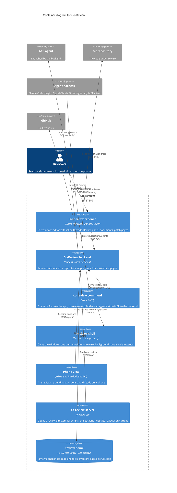

# Containers

Level 2 of the [C4 model](README.md): the separately running parts of Co-Review and how they talk. Libraries that are bundled into a part (the review model in `src/common`, Tree-sitter, Theia itself) are not containers; [the component diagram](c4-components-review-backend.md) shows the inside of the backend.

## Reading it

- **One backend serves everything.** The workbench, the phone view, the MCP bridge and `co-review-server` all talk to the same Node.js process, so every frontend and every agent sees the same review state.
- **The desktop shell owns the windows.** It opens one per repository or review. To show a review, the backend launches the app again with the repository and `--review=<id>`; the running shell receives it as a second instance and opens or focuses that review's window. Those two arrows are left off this diagram because they would cross other boxes; [the dynamic diagram](c4-dynamic-agent-review.md) draws the second. The shell is also optional: from a checkout, `co-review` starts the browser app on `127.0.0.1:3000` and there is no Electron main process. Installed from the app, the same command runs inside the bundle and the desktop shell owns the windows; in the browser app, showing a review opens the system browser on it instead. [Running and packaging](../running-and-packaging.md) has both paths.
- **Agents never talk to the backend directly.** A harness runs `co-review mcp`; the bridge finds the backend through `server.json` in the review home, starts the app if it is not running, and forwards tool calls. The Claude Code plugin, the Pi package and the Oh My Pi package all do this.
- **The review home is outside the repository.** Reviews, snapshots and the repository map live under `~/.co-review` (`CO_REVIEW_HOME`), so a review never shows up as a change in the repository.
