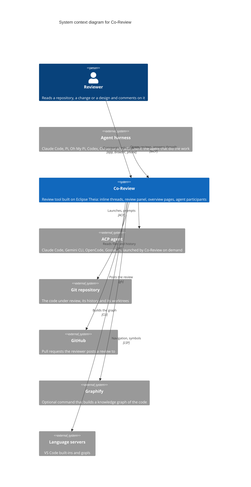

# System context

Level 1 of the [C4 model](README.md): Co-Review, who uses it, and the systems around it. Everything inside Co-Review is one box here; [the container diagram](c4-containers.md) opens it.

## Reading it

- **The reviewer** is one person whichever surface they use: the desktop app, a browser tab, or the phone view.
- **Two kinds of agent.** An *agent harness* starts Co-Review: the agent that built the change opens a review from its own session and stays as co-reviewer. An *ACP agent* is the opposite direction: Co-Review launches it when the reviewer clicks **Connect agent** and wants an on-call expert. [How agents review with you](../agents.md) compares the two.
- **Graphify and language servers are optional.** Without Graphify the overview is built from the Tree-sitter map alone. Without a language server for a language, Co-Review's own Tree-sitter symbols still give breadcrumbs and outlines.
