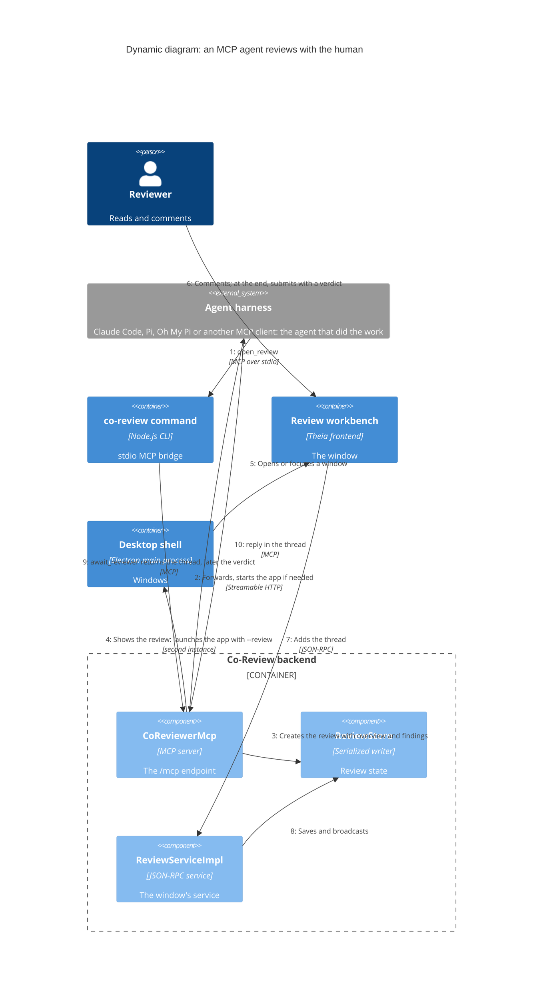

# An agent opens a review and answers in it

A dynamic [C4](README.md) diagram of the central flow: the agent that did the work opens a review from its own harness, the reviewer comments, the agent answers in the thread, and the review ends with a verdict. This is what `/co-review:review`, `/co-review:pr` and `/co-review:audit` all do underneath ([the workflows](../workflows.md)).

## Reading it

- **Waiting costs nothing.** After step 8 the agent is blocked in `await_reviewer`, which returns only when a thread changes or the reviewer submits (step 9). In Claude Code with the channel on, the thread arrives as a pushed message instead, and the agent answers with `reply` on it (step 10). Steps 6 to 10 repeat until the reviewer submits; then `await_reviewer` returns the verdict and the agent acts on it.
- **The window is the agent's.** In an app started in the background, when the last agent using a window it showed is done (the review was submitted, or the agent's MCP session ended), the window says so and closes after a countdown unless the reviewer keeps it open. Closing the window tells the agent the review is closed.
- **Nothing in this flow is Claude-specific.** The Pi and Oh My Pi packages run the same bridge and the same tools under their own names; any MCP client can do the same.
