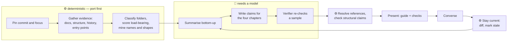
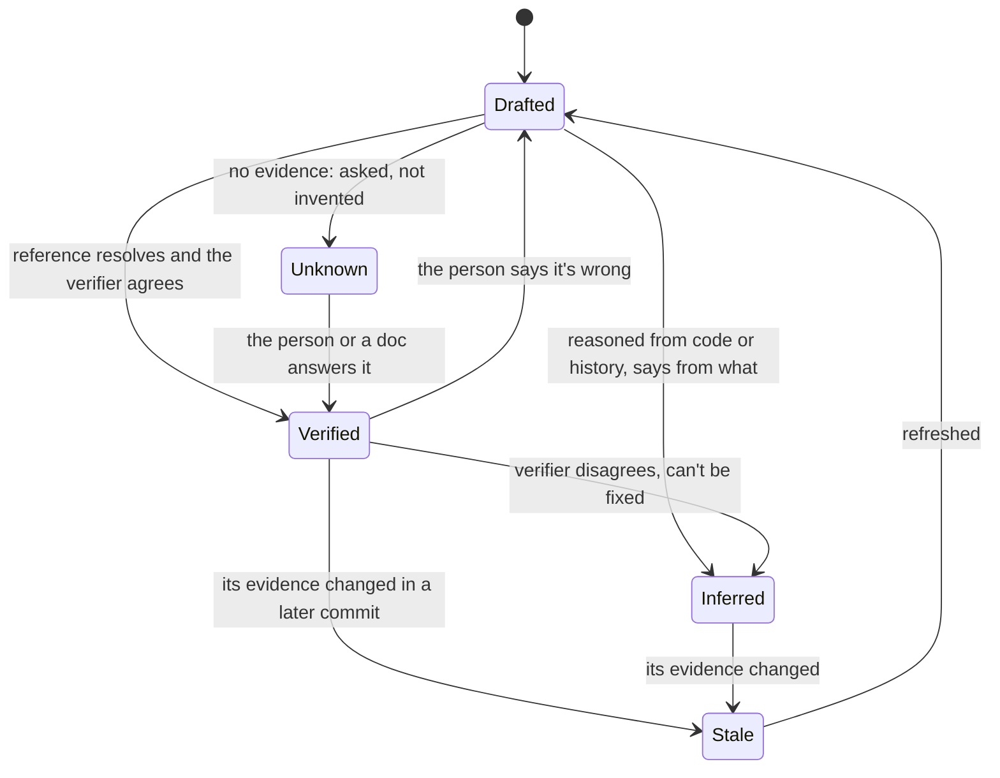

# Making a repository understood: the method, as pseudocode

## Context

This is the method behind `/co-review:audit`, written so it can be reimplemented in any language (a Rust port
is planned) without reading the prompt. The prompt (`prompts/audit.md`) is today's implementation: one agent
follows these steps, starting from the ⚙ facts Co-Review computes itself (`repo_facts`, in
`extensions/review/src/node/repo-facts.ts`: the evidence, the folder roles and map depth, load-bearing code, naming,
repeated shapes and history below). Why the method looks like this: [the proposal](understanding-a-repository.md) and
[ADR 0001](../adr/0001-understanding-first-repository-review.md).

**The target.** A person understands a repository when, without help, they can do nine things (U1–U9): say its
purpose and boundary, find their way around its map, use its vocabulary and data model, trace its flows, say why it
is built this way, recognise its patterns, naming and house rules, know where it is fragile, place a change and
predict what it affects, and know whether their picture is still current. Familiarity (the names ring a bell) is not
the goal; prediction is.

**Markers.** ⚙ deterministic: tools and arithmetic over the code and git, the same answer every run, the part to port
first. 🧠 needs a model: judgement, naming, explanation. Every 🧠 step consumes ⚙ output and produces *claims*, never
structure. `?` an open decision. `⚠` a deliberate deviation.

**The pieces it passes around.**

| Piece | What it is |
|---|---|
| Evidence | where a fact comes from: a code reference (path, symbol, line), a commit, a doc, a graph edge |
| Claim | one sentence the guide states, with its evidence and a tag: verified, inferred (from what), or unknown |
| Area | a part of the repository that a person thinks of as one thing: a folder, or a graph cluster |
| Folder note | a folder's one-line job, its role, its key files, what it depends on and what uses it |
| Term | a word of the repository's vocabulary: its meaning here, the code that embodies it, where it's used |
| Entity | a core thing the code manages: its lifecycle (states and transitions) and a sample of its stored form |
| Flow | an entry point traced end to end: the actors, numbered stops in the code, and what happens on failure |
| Pattern | a shape the code repeats: a short real example, where it's used, why, how to write a new one |
| Naming rule | how one kind of thing is named (files, types, functions, tests, config) and what the name signals |
| Lookup | "to find or change X, look in Y, named like Z" |
| House rule | a convention with its example, its enforcement and what breaks without it |
| Recipe | the files a past "add a new X" commit touched, in order |
| Decision | a design choice, why, what it guards against; documented, inferred or unknown |
| Hotspot, coupling, gap | where change concentrates, what changes together, what's untested or dead |
| Check | one prediction question per chapter, with an answer key the person doesn't see |
| Guide | the four chapters, the commit they were written for, and every claim in them |

⚠ The table is a separate section, which a change design wouldn't have; a port needs the shapes named once.

## Design

- **Fix what is being explained**
  - ⚙ pin the commit (short sha, date) — every claim is true *as of* this commit
  - ⚙ apply the focus if one is given: a folder or feature narrows every later step; chapter 1 still says how it
    fits the whole
  - ⚙ find the last guide for this repository — present → go to *Stay current* instead of starting over
- **Gather the evidence** — nothing is written until this is done; the pilot found it made every later step faster
  - ⚙ read the human-written sources first: README, docs, AGENTS.md / CLAUDE.md, ADRs, the manifests and build files,
    the CI config
  - ⚙ map the structure: every file's definitions (Tree-sitter), and the import/call graph with its clusters when a
    graph tool is available
    - no graph → build a coarser one from imports alone; never skip structure and fall back to impressions
  - ⚙ mine the history: per-file churn, pairs of files that change together, authors per area, commits that added
    "a new X"
    - ignore commits touching more than ~50 files — they are formatting or moves, and fake every coupling
    - fewer than ~50 commits → mark history as thin; later steps say so in a line instead of inferring from noise
  - ⚙ inventory the entry points and external contracts: binaries and scripts in the manifests, `main`s, route,
    command and tool registrations, scheduled jobs, event handlers, file formats read and written, outbound calls
    (HTTP clients, spawned CLIs), environment variables — this list decides the flows, not taste
- **Build the model bottom-up** — summarising a whole module at once is less accurate than composing it
  - 🧠 summarise each important file in one line from its definitions and a read of its core, then each folder from
    its files, each area from its folders, the system from its areas
  - ⚙ classify each folder's role
    - generated: a "do not edit" header, a `*.gen.*` name, or the output of a codegen command in the build files
    - vendored: `vendor/`, `third_party/`, copied dependencies; tests by path and name; tooling: scripts, CI, build
    - the rest by graph position: imported by many and importing little → infra; importing many and imported by
      few → glue; owning the types the rest use → core; 🧠 confirms the borderline ones
  - ⚙ decide how deep the map goes: descend while a folder mixes roles or holds more than ~40% of the files, at most
    four levels; stop where a folder's purpose is uniform
  - ⚙ score load-bearing code: callers and importers in the graph (in-degree, then a PageRank-style rank)
- **Extract what a person needs to know**, as claims
  - **Lay of the land (U1, U2)**
    - 🧠 purpose, users, and what it doesn't do — from the docs, checked against the entry points
    - ⚙ the context: the system and everything it talks to, from the external contracts
    - ⚙ the commands to build, run, test and deploy — taken from the build files and CI, not paraphrased
    - 🧠 a folder note per mapped folder, from the bottom-up summaries and the role; "you can ignore" for generated
      and vendored
  - **How it works (U3, U4)**
    - ⚙ vocabulary candidates: split every identifier into words, keep nouns frequent across many folders and
      present in type names or docs, drop language and framework words; 🧠 defines each in the repository's terms
    - ⚙ confusable names: identifiers sharing a head word that differ by suffix or prefix (`ReviewStore`,
      `ReviewService`, `ReviewManager`) → 🧠 a "cast of characters" table saying what each is for
    - ⚙ entities: the types that are persisted or sent; their states from enum and status fields and the code that
      assigns them; a real sample from fixtures, tests or a stored file → 🧠 explains the lifecycle
    - for each entry point → ⚙ walk the graph from it to the persistence and external calls it reaches; 🧠 writes the
      flow: its actors, 5–12 numbered stops (what happens and why there), and what happens when each stop fails
      - a path the graph can't follow (dynamic dispatch, reflection, messages) → read the code; still unclear → name
        it as not traced
  - **Patterns, naming, and why (U5, U6)** — the part that makes code look like it belongs here
    - ⚙ patterns: find shapes repeated at least three times — functions or files with the same syntax skeleton once
      names are normalised, the same registration call, the same set of sibling files per folder (one adapter per
      provider) → 🧠 names each in the code's own terms; a textbook name (MVC, repository, observer) only when it
      really fits, and then how this code differs; a real example, where used, why, how to write a new one
    - ⚙ naming: per kind of thing (folders, files, types, functions, tests, config keys) count the prefixes,
      suffixes, verbs and casings; a form covering most of its kind (~70%, at least five instances) is a rule, the
      rest are deviations → 🧠 reads a few examples per verb or suffix and says what it signals (`get` reads memory,
      `load` reads disk)
    - ⚙ lookups: for the common tasks (add an endpoint, a command, a table, a config key, a test; fix a UI string)
      the folders and name forms where past commits made that change → 🧠 writes "to find or change X, look in Y,
      named like Z"
    - ⚙ house rules and their enforcement: linters, formatters, generators, check scripts, CI steps, and what each
      fails on → 🧠 one rule each, with an example, how it is enforced (or "nothing") and what breaks without it
    - ⚙ recipes: commits whose message says add, new or introduce and whose set of touched files recurs → 🧠 the
      steps, in order
    - 🧠 decisions: from docs and ADRs (documented), from commit and PR text or the code's shape (inferred, saying
      from what), the defensive ones included (what edge case each guards against); no evidence → unknown, and asked
    - thin history and no design docs → decisions and recipes shrink to a paragraph; patterns, naming, lookups and
      rules stay — they need only the code
  - **Where it hurts (U7)**
    - ⚙ hotspots: churn rank × size rank; coupling: pairs that change together in most of their commits, especially
      across areas
    - ⚙ gaps: source files no test reaches by name or import; definitions with no inbound reference that aren't
      entry points (dead, 🧠 confirms — dynamic use hides callers); trust boundaries where outside input enters
    - 🧠 findings: at most three per area, what's wrong, why it matters, what to do, with a severity, on the code
- **Make it true** — a guide that is confidently wrong is worse than none
  - every claim carries its evidence and a tag; a structural claim (depends on, calls, is used by) must match a graph
    edge or is downgraded to inferred
  - ⚙ resolve every code reference: the file exists, the symbol is there; a stale line is re-found by symbol
  - 🧠 a separate verifier, reading only the code, re-checks a sample of verified claims (all of chapter 3's
    decisions); a failure is fixed or downgraded, never left
  - describe mechanisms, not plausible summaries — "fills the marked regions in these files", not "copies them"; the
    pilot's one misleading claim was a paraphrase
- **Present it as four chapters**
  - lay of the land → how it works → patterns, naming, and why → where it hurts — top-down first, then the detail
  - every heading says what the reader learns by reading it; every claim links to its code, the symbol as the text
  - each chapter ends with one check: a prediction ("where would you add a new command, and what else would you
    touch?"); its answer key stays with the agent, not on the page
  - the guide opens with the commit it was written for; the findings follow the guide
- **Converse until the person is done**
  - a comment answering a check → compare with the answer key and the code; say what is right first, then what is
    missing, with a link; no score
  - a comment saying the guide is wrong → re-check the code; wrong → fix the guide, say what changed
  - any other question → answer it from the code, briefly, in the thread
  - the person submits a verdict on the findings → act on what they accepted, as in an audit
- **Stay current** — the guide is only useful while it's true
  - ⚙ diff the pinned commit against now: changed files, new and removed entry points, changed definitions
  - ⚙ mark every claim whose evidence changed as stale; collect the chapters and flows they belong to
  - open with "since you last read this": the commits, the areas that changed, the terms and flows affected
  - rebuild only the stale parts; re-pin the commit
  - `?` keep every past guide, or only the latest? (Q1)

## Diagrams

The pipeline, with the porting boundary:

A claim's life:

## Open Questions

1. Keep every past guide, or only the latest? Recommended: keep each pinned guide; the latest is shown, and the
   older ones are what "since you last read this" is computed against.

## How to know an implementation works

Measure ability, not satisfaction. The pilot used this harness, and a port should keep it as its test suite:

- one agent with the code writes held-out questions, about two per ability, with answers checked against the code
- a reader with *only* the guide answers them, with a confidence per answer
- a grader with the code marks each correct, partial or wrong, samples the guide's claims for accuracy, and lists
  every confident-but-wrong answer
- pass: no confident-but-wrong answers, at least three-quarters correct, and no wrong claims in the sample. The
  pilot on Co-Review: 20 correct, 6 partial, 0 wrong of 26; 13 of 15 sampled claims accurate, 2 partly
